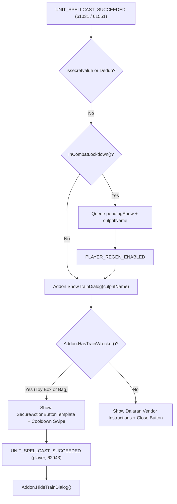

# Train Wrecker Addon (`TrainWrecker`) — Implementation Plan

## 1. Goal & Scope

Build a standalone World of Warcraft addon (**Train Wrecker**, package and
directory name `TrainWrecker`) supporting both **Mists of Pandaria Classic**
(`50504`) and **Retail** (`120100`), configured for automated **CurseForge**
packaging and deployment following the project layout and CI/CD conventions of
`bagnon_consolidator`.

### Core Behavior

1. **Automatic Train Detection:** Detect when a **Toy Train Set** (Item ID
   `44606`, Placement Spell ID `61031`, Pulse Spell ID `61551`) is placed or
   pulses nearby.
2. **"Silence the train" Dialog Window:** When a Toy Train Set is detected,
   display a movable dialog window titled **"Silence the train"**:
   - **Player owns the Wind-Up Train Wrecker (Item ID `45057`):** Show the
     secure action button (`SecureActionButtonTemplate`) to summon the **Wind-Up
     Train Wrecker** regardless of whether the toy is currently on its 30-minute
     cooldown. Display a cooldown swipe overlay (`CooldownFrameTemplate`) on the
     button icon when the toy is on cooldown. Automatically close the dialog
     when the player successfully casts **Wind-Up Train Wrecker** (Spell ID
     `62943`).
   - **Player does not own the Wind-Up Train Wrecker:** Hide the secure action
     button and display a message explaining where to obtain the toy (**Jepetto
     Joybuzz** at the **Wonderworks** toy shop in **Dalaran** for **250 gold**),
     along with a standard **Close** button.
3. **No Sound-Muting Fallback:** Do not mute game or emote sound files.

---

## 2. Repository Structure (Modeled on `bagnon_consolidator`)

```text
TrainWrecker/
├── .agents/
│   └── rules/
│       └── train_wrecker_maintenance_rules.md
├── .github/
│   └── workflows/
│       ├── release.yml          # CurseForge release via BigWigsMods/packager@v2 (CF_API_KEY)
│       └── typecheck.yml        # Lua 5.1 syntax check, unit tests, and LuaLS typecheck
├── core/
│   ├── init.lua                 # Namespace setup, SavedVariables init, slash command (/tw)
│   └── detector.lua             # Toy ownership check, train detection, combat lockdown queue
├── docs/
│   └── project_context.md       # Project context, architectural decisions, and checklist
├── locales/
│   ├── locales.xml              # Locale script loader
│   └── enUS.lua                 # Default English localization dictionary
├── scripts/
│   └── setup_types.sh           # Sparse-clones Ketho/vscode-wow-api & FramexmlAnnotations into .types/
├── tests/
│   └── test_train_wrecker.lua   # Standalone Lua 5.1 unit test suite with mocked WoW environment
├── ui/
│   └── dialog.lua               # "Silence the train" dialog and SecureActionButtonTemplate button
├── .gitignore                   # Ignores .types/ and non-rule .agents/ files
├── .luarc.json                  # LuaLS 5.1 configuration pointing to .types/wow-api/Annotations
├── .markdownlint.json           # 80-character prose linting rules
├── .pkgmeta                     # BigWigsMods/packager configuration for CurseForge
├── .prettierrc                  # 80-character prose wrap formatting
├── CHANGELOG.md                 # Release changelog consumed by .pkgmeta
├── LICENSE                      # MIT License
├── README.md                    # Addon overview, usage, and CurseForge description
├── TrainWrecker.toc             # Multi-flavor manifest (Retail 120100 + MoP Classic 50504)
├── main.xml                     # Root XML script loader
└── types.lua                    # ---@meta EmmyLua type declarations for LuaLS
```

---

## 3. Component Design & Technical Specifications



### 3.1 Manifest & CurseForge Packaging

#### `TrainWrecker.toc`

Uses the multi-flavor `## Interface:` directive supported by both modern WoW
clients and `BigWigsMods/packager@v2` (passing `wow_toc_validate` with zero
warnings):

```toc
## Interface: 120100, 50504
## Title: Train Wrecker
## Notes: Detects Toy Train Sets and prompts to deploy the Wind-Up Train Wrecker.
## Author: LVE
## Version: @project-version@
# FileDataID: inv_misc_head_clockworkgnome_01
## IconTexture: 134152
## Category: Miscellaneous
## SavedVariables: TrainWreckerDB
## X-Curse-Project-ID: REPLACE_WITH_CURSE_PROJECT_ID

main.xml
```

> [!IMPORTANT] After creating the project on CurseForge, replace
> `REPLACE_WITH_CURSE_PROJECT_ID` in `TrainWrecker.toc` with the numeric
> CurseForge Project ID, and add `CF_API_KEY` to the GitHub repository secrets.

#### `.pkgmeta`

```yaml
package-as: TrainWrecker

manual-changelog:
  filename: CHANGELOG.md
  markup-type: markdown

ignore:
  - .agents
  - .github
  - .gitignore
  - .luarc.json
  - .markdownlint.json
  - .prettierrc
  - .types
  - docs
  - scripts
  - tests
  - types.lua
```

#### `main.xml` & `locales/locales.xml`

`main.xml` loads files in strict topological order:

```xml
<Ui xmlns="http://www.blizzard.com/wow/ui/">
  <!-- Localization Dictionaries -->
  <Include file="locales/locales.xml"/>

  <!-- Core Lifecycle & Detection -->
  <Script file="core/init.lua"/>
  <Script file="core/detector.lua"/>

  <!-- User Interface -->
  <Script file="ui/dialog.lua"/>
</Ui>
```

#### GitHub Actions (`.github/workflows/typecheck.yml` & `release.yml`)

- **`typecheck.yml`**: Runs on pushes and pull requests to `main`/`master` and
  `workflow_call`:
  1. Checks out repository (`actions/checkout@v7`).
  2. Installs Lua 5.1.5 (`leafo/gh-actions-lua@v13`).
  3. Runs syntax check:
     `luac -p locales/*.lua core/*.lua ui/*.lua types.lua tests/test_train_wrecker.lua`
  4. Runs unit tests: `lua tests/test_train_wrecker.lua`
  5. Runs `bash scripts/setup_types.sh`
  6. Runs LuaLS static type check (`mrcjkb/lua-typecheck-action@v1.1.0`,
     `checklevel: Warning`).
- **`release.yml`**: Runs on version tags (`v*`, `[0-9]+.[0-9]+.[0-9]+*`) and
  `workflow_dispatch`, depends on `verify` (`typecheck.yml`), and invokes
  `BigWigsMods/packager@v2` with `CF_API_KEY: ${{ secrets.CF_API_KEY }}`.

---

### 3.2 Namespace, Localization & Initialization (`locales/enUS.lua`, `core/init.lua`)

- **Standard Private Namespace:** Every Lua file starts with:

  ```lua
  ---@type string, TrainWreckerAddon
  local ADDON, Addon = ...
  ```

  `core/init.lua` also exposes `_G.TrainWrecker = Addon` for unit testing and
  inspectability.

- **Zero-Dependency Localization (`locales/enUS.lua`):** Initializes `Addon.L`
  with a fallback metatable (`__index = function(_, k) return k end`) and
  defines all UI strings:
  - `L["Silence the train"] = "Silence the train"`
  - `L["Train Placed By"] = "Toy Train Set placed by %s."`
  - `L["Train Detected Nearby"] = "A Toy Train Set was detected nearby."`
  - `L["Wind-Up Train Wrecker"] = "Wind-Up Train Wrecker"`
  - `L["Missing Toy Message"] =`
    `"You do not have the Wind-Up Train Wrecker toy. You can purchase it for"`
    `" 250 gold from Jepetto Joybuzz at the Wonderworks toy shop in Dalaran."`
  - `L["Close"] = "Close"`
  - `L["Cannot Open In Combat"] =`
    `"Cannot open the Train Wrecker dialog during combat."`
- **SavedVariables & Slash Commands (`core/init.lua`):**
  - Listens for `ADDON_LOADED` (`arg1 == ADDON`) to initialize
    `TrainWreckerDB = TrainWreckerDB or {}` (storing optional dialog position
    `point`, `relativePoint`, `x`, `y`).
  - Registers `/trainwrecker` and `/tw` (`SLASH_TRAINWRECKER1`,
    `SLASH_TRAINWRECKER2`) to open the dialog on demand for testing or manual
    use.

---

### 3.3 Train Detection & Toy Ownership (`core/detector.lua`)

- **Constants:**
  - `TOY_TRAIN_ITEM_ID = 44606`
  - `TOY_TRAIN_SPELL_ID = 61031` (Toy Train Set placement cast)
  - `TRAIN_PULSE_SPELL_ID = 61551` (Toy Train Set periodic pulse forcing
    `/train`)
  - `TRAIN_WRECKER_ITEM_ID = 45057`
  - `TRAIN_WRECKER_SPELL_ID = 62943` (Wind-Up Train Wrecker cast)
  - `DEDUP_WINDOW_SECONDS = 3`
- **Ownership Check (`Addon.HasTrainWrecker()`):**
  1. Checks `PlayerHasToy and PlayerHasToy(45057)`. If true, returns
     `true, "toy"`.
  2. Checks `C_Item and C_Item.GetItemCount and C_Item.GetItemCount(45057) > 0`
     (covers players who just bought the item from Jepetto Joybuzz and still
     have it unlearned in their bags). If true, returns `true, "item"`.
  3. Otherwise returns `false, nil`.
- **Event Handling (`UNIT_SPELLCAST_SUCCEEDED`, `TOYS_UPDATED`,
  `BAG_UPDATE_DELAYED`):**
  - **Secret Value Guard:** At the start of
    `UNIT_SPELLCAST_SUCCEEDED(unitTarget, castGUID, spellID)`, guard against
    Retail 12.0+ / MoP Classic secret values during restricted encounters:

    ```lua
    if issecretvalue and (issecretvalue(spellID) or issecretvalue(castGUID) or issecretvalue(unitTarget)) then
      return
    end
    ```

  - **Train Placement / Pulse (`spellID == 61031` or `spellID == 61551`):**
    - Deduplicates by `castGUID` and a 3-second cooldown window (`GetTime()`) so
      that a single cast reported across multiple unit tokens (`party1`,
      `raid1`, `target`, `nameplate1`) does not spam updates.
    - Resolves `sourceName` when `spellID == 61031` via `UnitName(unitTarget)`
      (verifying `not (issecretvalue and issecretvalue(sourceName))`).
    - Calls `Addon.ShowTrainDialog(sourceName)`.
  - **Wrecker Cast (`unitTarget == "player"` and `spellID == 62943`):**
    - Calls `Addon.HideTrainDialog()` to auto-dismiss the dialog once the
      Wrecker is deployed.
  - **Mid-Session Toy Acquisition (`TOYS_UPDATED`, `BAG_UPDATE_DELAYED`):**
    - Calls `Addon.RefreshTrainDialog()` if the dialog is currently shown or
      queued, so buying or learning the toy while the dialog is open
      automatically transitions from the missing-toy instructions to the active
      button (or from `type = "item"` to `type = "toy"`).

---

### 3.4 Dialog Window & Combat Lockdown Safety (`ui/dialog.lua`)

- **Frame Hierarchy & Layout:**
  - `TrainWreckerDialogFrame`:
    `CreateFrame("Frame", "TrainWreckerDialogFrame", UIParent, "BackdropTemplate")`,
    size `360x160`, `DIALOG` strata, clamped to screen, movable out of combat,
    using standard dialog backdrop (`UI-DialogBox-Background` /
    `UI-DialogBox-Border`).
  - **Title:** `GameFontHighlightLarge` centered at top with text
    `L["Silence the train"]`.
  - **Close Button (`UIPanelCloseButton`):** Anchored at `TOPRIGHT`. Overrides
    the default template `OnClick` script:

    ```lua
    closeBtn:SetScript("OnClick", function()
      Addon.HideTrainDialog()
    end)
    ```

  - **Subtitle / Status Text:** Displays
    `string.format(L["Train Placed By"], culpritName)` when `culpritName` is
    known, or `L["Train Detected Nearby"]` when unknown. If the dialog is
    already shown (or queued) with a known `culpritName`, a subsequent `61551`
    pulse with `sourceName == nil` preserves the known `culpritName`.
  - **Owned State (`actionBtn`):**
    - Created via
      `CreateFrame("Button", "TrainWreckerActionButton", dialogFrame,`
      `"SecureActionButtonTemplate, UIPanelButtonTemplate")`, size `240x36`.
    - Calls `actionBtn:RegisterForClicks("AnyUp", "AnyDown")` so hardware clicks
      fire regardless of the player's `ActionButtonUseKeyDown` CVar on both MoP
      Classic and Retail.
    - Displays a left-aligned 28x28 icon texture set to
      `134152 -- FileDataID: inv_misc_head_clockworkgnome_01` and a child
      `Cooldown` widget (`CooldownFrameTemplate`) overlaying the icon.
    - Sets secure attributes out of combat:
      - When `sourceType == "toy"`: `SetAttribute("type", "toy")`,
        `SetAttribute("toy", 45057)`, `SetAttribute("item", nil)`.
      - When `sourceType == "item"`: `SetAttribute("type", "item")`,
        `SetAttribute("item", "item:45057")`, `SetAttribute("toy", nil)`.
    - Updates the cooldown spiral via `C_Container.GetItemCooldown(45057)` on
      show and on `SPELL_UPDATE_COOLDOWN` / `BAG_UPDATE_COOLDOWN`:
      - Calls `cooldown:SetCooldown(startTime, duration)` when
        `startTime and duration and enable == 1 and startTime > 0`
        `and duration > 0`.
      - Calls `cooldown:Clear()` otherwise.
      - The button remains visible and enabled regardless of cooldown status.
  - **Unowned State (`missingText` & `dismissBtn`):**
    - `missingText`: Word-wrapped `GameFontNormal` FontString showing
      `L["Missing Toy Message"]`.
    - `dismissBtn`: Standard `UIPanelButtonTemplate` button (`L["Close"]`)
      calling `Addon.HideTrainDialog()`.
- **Combat Lockdown Protection (`InCombatLockdown()`):**
  - Because `TrainWreckerDialogFrame` is the parent of a
    `SecureActionButtonTemplate` child, showing, hiding, moving, or setting
    attributes on it during `InCombatLockdown()` is forbidden.
  - **Deferred Show / Refresh / Hide:**
    - If `Addon.ShowTrainDialog(sourceName)` is called during
      `InCombatLockdown()`, it sets `pendingShow = true` (and
      `pendingHide = false`), preserving any non-nil `pendingSource`.
    - If `Addon.RefreshTrainDialog()` is called during `InCombatLockdown()`, it
      sets `pendingRefresh = true`.
    - If `Addon.HideTrainDialog()` is called during `InCombatLockdown()`, it
      sets `pendingHide = true` and `pendingShow = false`.
    - When `PLAYER_REGEN_ENABLED` fires, pending state transitions execute
      immediately out of combat.
  - **Safe Dragging Around Combat:**
    - `OnDragStart` and `OnDragStop` check
      `if InCombatLockdown() then return end` and maintain
      `dialogFrame.isMoving`.
    - On `PLAYER_REGEN_DISABLED` (entering combat), if `dialogFrame.isMoving` is
      true, `dialogFrame:StopMovingOrSizing()` is called immediately before
      lockdown completes.
  - **No `UISpecialFrames` Registration:** `TrainWreckerDialogFrame` is
    intentionally excluded from `UISpecialFrames` so pressing `Escape` during
    combat does not cause `CloseSpecialWindows()` to call `:Hide()` on a
    protected parent frame.

---

## 4. Architecture Review

A single-pass Architecture Review
(`conversation://2120d052-f775-47e4-a5e8-88f78bba08a6`) was conducted against
scope constriction, component boundaries, lifecycle impacts, and WoW
taint/combat lockdown rules. The following findings were reconciled into this
plan:

1. **Tone & Style Alignment:** Standardized the culprit string in
   `locales/enUS.lua` to `"Toy Train Set placed by %s."` (without exclamation
   marks).
2. **Mid-Session Toy Acquisition (`TOYS_UPDATED` & `BAG_UPDATE_DELAYED`):**
   Added listeners for `TOYS_UPDATED` and `BAG_UPDATE_DELAYED` so purchasing the
   toy from Jepetto Joybuzz or learning it from bags into the Toy Box while the
   dialog is open refreshes the dialog state (or queues `pendingRefresh` if in
   combat).
3. **`UIPanelCloseButton` & Dragging Combat Guards:** Explicitly overrode
   `UIPanelCloseButton`'s default `OnClick` script to route through
   `Addon.HideTrainDialog()`, and guarded `OnDragStart`/`OnDragStop` with
   `InCombatLockdown()` checks plus a `PLAYER_REGEN_DISABLED` drag-stop handler.
4. **Cooldown Widget Methods:** Grounded cooldown display in widget methods
   `cooldown:SetCooldown(startTime, duration)` and `cooldown:Clear()` rather
   than the removed `CooldownFrame_Set` global.
5. **Secret Value Guard (`issecretvalue`):** Added an `issecretvalue` check on
   `UNIT_SPELLCAST_SUCCEEDED` payloads (`spellID`, `castGUID`, `unitTarget`) and
   `UnitName(unitTarget)` for Retail 12.0+ (`Midnight`) and MoP Classic
   encounter safety.
6. **Culprit Name Preservation Across Pulses:** Ensured that periodic `61551`
   pulse detections (`sourceName == nil`) do not overwrite a known culprit name
   already displayed or queued from the initial `61031` placement cast.

---

## 5. Verification Plan

Execute the following commands and MCP validations from the repository root to
verify syntax, unit tests, static types, WoW domain/taint rules, manifest
schemas, and Markdown formatting:

### 5.1 Automated Unit Tests & Lua 5.1 Syntax Check

```bash
# 1. Verify Lua 5.1 bytecode compilation across all scripts
luac -p locales/*.lua core/*.lua ui/*.lua types.lua tests/test_train_wrecker.lua

# 2. Run the standalone unit test suite (tests ownership, dedup, culprit preservation,
#    cooldown display, mid-session learning, and combat lockdown queueing)
lua tests/test_train_wrecker.lua
```

### 5.2 Static Type Checking (LuaLS Pillar 1)

```bash
# Download Ketho/vscode-wow-api and NumyAddon/FramexmlAnnotations into .types/
bash scripts/setup_types.sh

# Run Lua Language Server static analysis with zero warnings/errors
lua-language-server --check . --checklevel=Warning
```

### 5.3 WoW Domain & Taint Linting (`wow_lua_lint` Pillar 2)

Run the `wow` MCP `wow_lua_lint` tool against every runtime `.lua` file
(`locales/enUS.lua`, `core/init.lua`, `core/detector.lua`, `ui/dialog.lua`) for
both supported flavors
(`knownGlobals: ["TrainWreckerDB", "SLASH_TRAINWRECKER1", "SLASH_TRAINWRECKER2"]`):

- **Retail (`120100`):** `flavor: "mainline"` — verify 0 errors and 0 warnings.
- **Mists of Pandaria Classic (`50504`):** `flavor: "mists"` — verify 0 errors
  and 0 warnings.

### 5.4 Manifest, XML & Markdown Validation (Pillar 3)

- **TOC Manifest Validation:** Run `wow_toc_validate` on `TrainWrecker.toc`
  (verify 0 errors and 0 warnings).
- **XML Schema Validation:** Run `wow_xml_validate` on `main.xml` and
  `locales/locales.xml` (verify 0 errors and 0 warnings).
- **Markdown Formatting & Linting:**

  ```bash
  npx prettier --check "**/*.md"
  npx markdownlint-cli2 "**/*.md"
  ```
